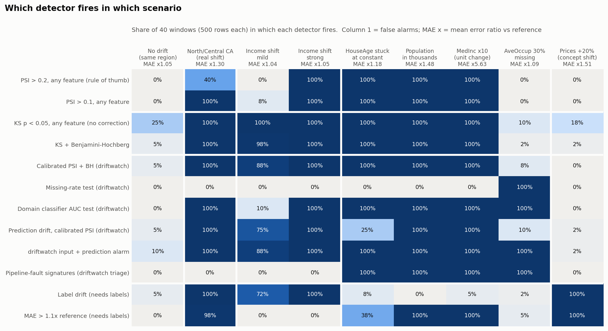
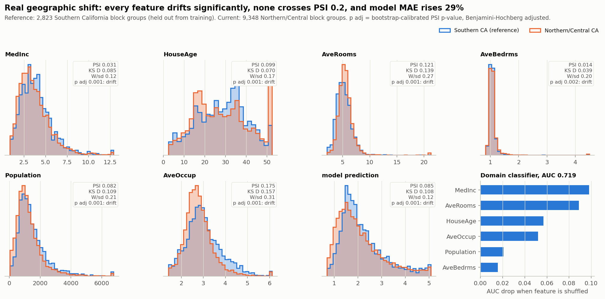
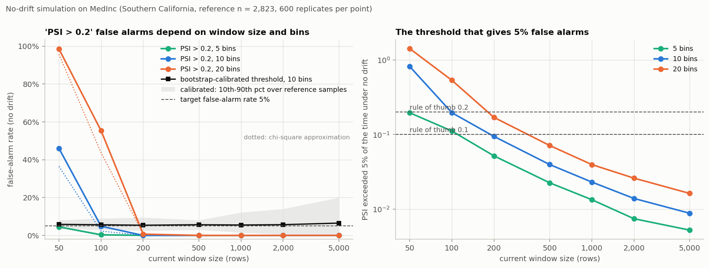
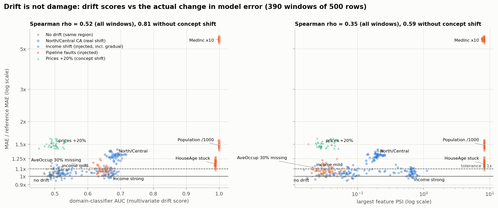
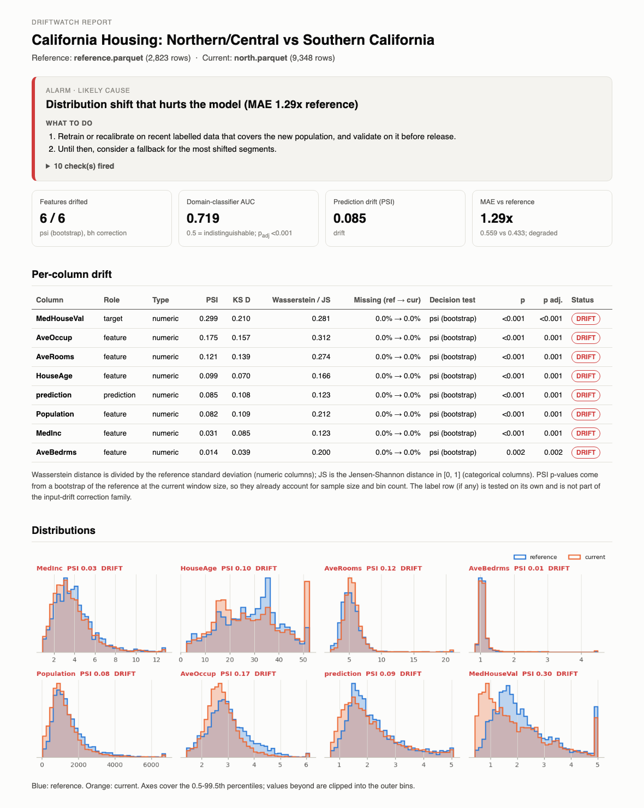

# ML Drift Monitor (`driftwatch`)

A model-monitoring library and CLI that detects data and prediction drift, calibrates its
alarms so they do not cry wolf, and measures, on a real distribution shift, when drift
actually hurts the model.

[](https://github.com/faiqrasulov/ml-drift-monitor/actions/workflows/ci.yml)

[](LICENSE)

## Key results

All numbers come from `make run` (about 2 minutes on a laptop CPU, peak RAM about 200 MB) and
are stored in [`reports/metrics.json`](reports/metrics.json). Data: California Housing
(20,640 block groups); a price model trained on Southern California is monitored on new data.

| What was checked | Result |
|---|---|
| Real shift: Northern/Central vs Southern California (9,348 vs 2,823 block groups) | All 6 features drift (calibrated PSI, BH-adjusted p <= 0.002), domain-classifier AUC **0.719**, model MAE **1.29x** the reference. The largest PSI is only **0.175**, so the popular "PSI > 0.2" rule stays silent |
| "PSI > 0.2" when nothing has changed (10 bins) | **46%** false alarms on 50-row windows, **0%** from 200 rows on; with 20 bins **55%** at 100 rows. The cut-off that actually gives 5% false alarms runs from **0.82** (50 rows) to **0.009** (5,000 rows) |
| driftwatch's bootstrap-calibrated PSI threshold | **5.4%-6.5%** false alarms at every window size from 50 to 5,000 rows (target 5%) |
| Domain classifier ("can a model tell old from new data?") | The common pooled cross-validation AUC test gives **10.7%** false alarms (target 5%); driftwatch's cross-fitted test gives **5.3%** |
| Drift vs damage, 390 monitored windows | A strong (injected) income shift trips every drift detector but MAE moves only **1.05x**; a +20% price shift leaves every input detector at its no-drift level while MAE rises **1.51x**. Rank correlation of domain AUC with the MAE ratio: **0.52** |
| Alarm triage (likely cause) | Pipeline-fault signatures in **100%** of windows of all four injected pipeline faults and **0%** of all other windows; the real North shift is classed "shift with damage" in **97.5%** of windows, the strong income shift "shift without damage" in **100%** |



## Problem & why it matters

A model's test-set accuracy is measured once, before deployment. Afterwards the data keep
changing (new customer segments, new regions, upstream schema changes, inflation), labels
arrive late or never, and accuracy degrades without any error being raised. Teams therefore
monitor the inputs and outputs for drift. In practice the alarms are badly calibrated in both
directions:

- **Noisy.** A fixed rule such as "PSI > 0.2" or "KS p < 0.05 on any feature" fires on pure
  sampling noise when windows are small or features are many. Alarms that fire every week get
  ignored.
- **Blind.** The same fixed cut-off misses real shifts when windows are large, and no input
  test can see a change in the input-output relationship (concept shift).
- **Drift is not damage.** Many shifts do not hurt the model at all, while a broken pipeline
  or a concept shift can be very costly. An alarm that cannot tell these apart leads either to
  needless retraining or to missed incidents.

`driftwatch` calibrates every alarm to a stated false-alarm rate, corrects for testing many
features at once, adds a multivariate test, checks performance once labels arrive, and
triages what it finds into a likely cause with next steps.

## Approach

All drift statistics are implemented from scratch on numpy. scipy, statsmodels and
scikit-learn metrics are used **in the tests** as independent references (scipy's special
functions also provide the chi-square tail).

| Module | What it does | Key design decision |
|---|---|---|
| `univariate.py` | PSI (reference-quantile bins), two-sample KS, normalised Wasserstein, Jensen-Shannon distance, chi-square, missing-rate z-test | PSI bins are the reference deciles with open outer bins; empty bins are floored at eps = 1e-4 so PSI stays finite; missing values are tested separately rather than hidden in a bin |
| `calibration.py` | Bootstrap null distribution of PSI, cached per window size; chi-square approximation | The bootstrap redraws a pseudo-reference *and* a pseudo-window from the reference and re-estimates the bins, so the threshold reflects window size, reference size, bin count, ties and the eps floor |
| `multiple_testing.py` | Bonferroni and Benjamini-Hochberg | One correction family per check: every column's test, every missing-rate test and the domain classifier |
| `multivariate.py` | Domain classifier: gradient boosting trained to tell reference rows from current rows, with permutation importances | **Cross-fitted**: each fold is scored only by a model that never saw its labels, giving an exact Mann-Whitney null per fold; fold p-values are combined with Bonferroni (valid under dependence). Pooling out-of-fold scores is not valid (see results) |
| `performance.py` | MAE / RMSE vs reference, rolling metrics | Tests H0: MAE <= 1.1 x reference MAE, so an alarm means "worse by more than the tolerance, beyond noise", not "any difference" |
| `monitor.py` | `DriftMonitor.fit(reference).check(window)` -> `DriftReport` | Calibrations are computed once and reused across windows; optional `min_psi` effect-size floor for very large windows |
| `triage.py` | Likely cause and next steps | Pipeline-fault signatures (constant column, order-of-magnitude scale change, missing-rate jump, unseen categories) are separated from genuine shift, which is split by whether performance degraded |
| `report.py`, `cli.py` | Self-contained HTML (inline CSS, base64 PNG charts, no template engine) and JSON; `driftwatch compare` | Exit code 0 = no alarm, 1 = alarm, 2 = input error, so the command can gate a CI job or a scheduled pipeline |

**The demo.** California Housing block groups are split at latitude 35 N. A
`HistGradientBoostingRegressor` predicts median house value from the six census features
(income, house age, rooms, bedrooms, population, occupancy), trained on half of the southern
rows (5,646). A second quarter (2,823 rows, never trained on) is the monitoring reference and
the performance baseline (MAE 0.433, i.e. $43k; R^2 0.69). Latitude and longitude are not
model inputs: they define the split, so they would drift by construction. The monitor then
sees:

- **(a) No drift:** the last quarter of Southern California (2,823 rows, held out).
- **(b) A real shift:** all 9,348 Northern/Central California block groups.
- **(c) Injected scenarios on (a)**, clearly synthetic because only then is the ground truth
  known: a covariate shift towards high-income areas (real rows resampled with weights
  exp(beta * z(log income)), beta = 0.25 or 1.0, and a gradual version over 30 windows);
  four pipeline faults (HouseAge stuck at a constant, Population sent in thousands, income
  multiplied by 10, 30% of AveOccup missing); and a concept shift (all prices +20%, inputs
  unchanged).

Each scenario is checked on 40 random windows of 500 rows, recording every detector's
decision, the domain AUC and the actual MAE ratio.

**Correctness checks** (60 tests, about 15 s): PSI = 0 for identical data and equal to a
hand-computed case; KS statistic vs `scipy.stats.ks_2samp` (exact) and its p-value within 0.02;
Wasserstein vs scipy; JS distance bounds and vs `scipy.spatial.distance.jensenshannon`;
chi-square vs `chi2_contingency`; missing-rate test vs statsmodels `proportions_ztest`;
Bonferroni / BH vs statsmodels `multipletests`; the bootstrap null mean vs chi-square theory;
domain-classifier AUC near 0.5 on same-distribution data and above 0.85 on shifted data;
triage classes; CLI exit codes and HTML generation; and an end-to-end pipeline run on tiny
synthetic data. No test touches the network.

## Results

### (a) A real shift that the rule of thumb misses



| Column | PSI | KS D | Wasserstein / SD | BH-adjusted p (calibrated PSI) |
|---|---:|---:|---:|---:|
| AveOccup | 0.175 | 0.157 | 0.31 | 0.001 |
| AveRooms | 0.121 | 0.139 | 0.27 | 0.001 |
| HouseAge | 0.099 | 0.070 | 0.17 | 0.001 |
| Population | 0.082 | 0.109 | 0.21 | 0.001 |
| MedInc | 0.031 | 0.085 | 0.12 | 0.001 |
| AveBedrms | 0.014 | 0.039 | 0.20 | 0.002 |
| model prediction | 0.085 | 0.108 | 0.12 | 0.001 |
| label (MedHouseVal) | 0.299 | 0.210 | 0.28 | 0.001 (tested separately) |

(0.001 is the smallest p-value 1,000 bootstrap replicates can give.) Every feature has
shifted, the domain classifier separates the regions with AUC 0.719 (income and rooms carry
most of the signal), and the model's MAE rises from 0.433 to 0.559 (1.29x; RMSE 1.18x). Yet
no feature reaches PSI 0.2. The rule's verdict also depends on the window: on 500-row windows
of the same northern data the largest PSI exceeds 0.2 in 40% of windows, purely through
sampling noise. The calibrated test fires in 100% of those windows.

### (b) Why "PSI > 0.2" is either noisy or blind



No-drift simulation: reference (2,823 rows) and current window drawn from the same Southern
California data, 600 replicates per point (Monte Carlo SE about 2 pp at 50%).

| Window rows | 50 | 100 | 200 | 500 | 1,000 | 2,000 | 5,000 |
|---|---:|---:|---:|---:|---:|---:|---:|
| P(PSI > 0.2), MedInc, 5 bins | 4.5% | 0.3% | 0% | 0% | 0% | 0% | 0% |
| P(PSI > 0.2), MedInc, 10 bins | 46.0% | 4.8% | 0% | 0% | 0% | 0% | 0% |
| P(PSI > 0.2), MedInc, 20 bins | 98.5% | 55.3% | 0.7% | 0% | 0% | 0% | 0% |
| PSI with 5% false alarms (10 bins) | 0.817 | 0.196 | 0.094 | 0.040 | 0.023 | 0.014 | 0.009 |
| Any of 6 features PSI > 0.2 (10 bins) | 96.5% | 23.7% | 0% | 0% | 0% | 0% | 0% |
| Any of 6 features KS p < 0.05, uncorrected | 20.3% | 25.7% | 21.2% | 22.7% | 23.0% | 19.8% | 19.5% |
| Any of 6 features, KS + Benjamini-Hochberg | 3.8% | 4.7% | 3.0% | 4.2% | 5.0% | 3.8% | 3.0% |
| **driftwatch calibrated PSI** (10 bins, MedInc) | **5.8%** | **5.6%** | **5.4%** | **5.6%** | **5.5%** | **5.7%** | **6.5%** |

Under no drift, PSI is approximately (1/n_ref + 1/n_cur) x chi-square(bins - 1), so a fixed
cut-off is a different test at every window size: it fires on noise below about 100 rows and
needs a large shift above a few hundred. The chi-square approximation (dotted lines) gets the
trend right but underestimates false alarms in small windows (36.5% vs 46.0% at 50 rows,
10 bins): with about 5 rows per bin the asymptotics are poor, and a single empty bin, floored
at eps, adds about 0.69 to PSI. The bootstrap includes both effects. The calibrated rate averages 40 independent reference samples,
each with only 200 bootstrap replicates for speed; its spread across references grows with the
window (shaded band), because with a large window the reference's own sampling noise
dominates.

### (c) The domain classifier needs cross-fitting to be valid

150 trials with two disjoint random samples of Southern California (2,823 vs 500 rows), so
there is no drift at all:

| Test | False alarms at alpha = 5% | 95% CI |
|---|---:|---:|
| Pooled out-of-fold scores of 5-fold CV, Mann-Whitney p-value (common practice) | 10.7% | 6.7%-16.6% |
| driftwatch: 2-fold cross-fitting, per-fold Mann-Whitney, Bonferroni | 5.3% | 2.7%-10.2% |

The pooled AUC's standard deviation under the null is 0.0187, 1.34x the 0.0140 that the
Mann-Whitney formula assumes: every fold's labels train the models that score the other folds,
so the pooled scores are not independent of the labels. The two cross-fitted fold statistics are
still correlated (r = 0.62), which is why they are combined with Bonferroni rather than averaged.

### (d) Which detector fires in which scenario

The heatmap at the top shows the share of 40 windows (500 rows each) in which each detector
fires; the column header gives the mean MAE ratio.

- **False alarms (no-drift column).** Uncorrected KS across 6 features fires in 25% of
  windows; KS + BH and each calibrated driftwatch detector in 0-5%. The combined driftwatch
  alarm (all its tests, one BH family) fired in 4 of 40 windows (10%, 95% CI 4%-23%), above
  its 5% design rate. The 40 windows are drawn from one 2,823-row held-out pool whose own MAE
  is 4% above the reference's, so they share that pool's chance differences; the clean
  simulations in (b) and (c) are the better calibration evidence. On the full held-out pool
  the CLI reports no alarm (exit code 0).
- **Mild income shift** (median income 9% above the reference): KS + BH 98%, calibrated PSI
  88%, PSI > 0.2 0%. MAE 1.04x: real drift, no damage.
- **Missing spike:** only the missing-rate test and the domain classifier (which sees the NaN
  pattern) notice; PSI and KS ignore missing values by design.
- **Concept shift (+20% prices):** no input or prediction detector can fire; only label drift
  and the performance check (both need labels) catch the 1.51x MAE.
- **Triage** (share of the 40 windows given each verdict):

| Scenario | Triage verdict |
|---|---|
| No drift | no action 85%, shift without damage 10%, concept shift 5% |
| North/Central CA (real) | shift with damage 97.5%, shift without damage 2.5% |
| Income shift, mild / strong | shift without damage 87.5% / 100% |
| HouseAge stuck, Population in thousands, MedInc x10, AveOccup missing | pipeline fault 100% in each |
| Prices +20% (concept shift) | concept shift 97.5%, shift with damage 2.5% |

### (e) Drift is not damage



Spearman rank correlation between each drift score and the MAE ratio, over windows:

| Windows | n | Domain AUC | Largest feature PSI | Prediction PSI | # features drifted |
|---|---:|---:|---:|---:|---:|
| All scenarios | 390 | 0.52 | 0.35 | 0.24 | -0.10 |
| Excluding the concept shift | 350 | 0.81 | 0.59 | 0.42 | 0.09 |
| Covariate shifts only (no drift, North, income) | 190 | 0.50 | 0.17 | 0.12 | 0.53 |

Interpretation:
- Drift scores track damage mainly because broken pipelines are both very visible and very
  harmful (income x10: MAE 5.6x). Among genuine covariate shifts the link is weak: the strong
  income shift (domain AUC 0.67, PSI 0.68) costs nothing (MAE 1.05x), while the North shift
  with a similar AUC (0.68) costs 1.30x, because there the price-income relationship differs
  too.
- Counting drifted features is useless as a damage proxy (rho -0.10).
- Of 303 windows with an input-drift alarm, 116 (38%) had no damage (MAE within 1.1x), mostly
  income shifts and the missing spike. Of 231 windows with damage, 44 (19%) raised no input
  alarm: 39 concept-shift windows, 4 no-drift windows whose MAE exceeded 1.1x by chance, and
  1 gradual-shift window.
- A unit change in an unimportant feature still hurt: Population sent in thousands cost 1.48x
  MAE, because 97.8% of the values fell below the smallest Population seen in training.
  Permutation importance ranks Population last (shuffling it raises MAE by 0.010, against
  0.571 for income), so "drift in unimportant features is harmless" does not hold for
  out-of-range values.

**Gradual drift.** Over 30 windows the income mix shifts from none to strong (beta 0 to 1,
median income +41% at the end). The driftwatch alarm first fires at window 7 (median income
+12.5%) and stays on in every later window; KS + BH fires at window 6, the domain classifier at
window 8, PSI > 0.2 only at window 13 (+19.6%). The performance check never fires: the MAE
ratio peaks at 1.16x in a single window and is 1.09x in the last, never significantly above the
1.1x tolerance. A performance-only monitor would have stayed quiet, correctly, and a drift-only
monitor would have recommended a retrain the model did not need.

**What did not work as well.** The combined alarm's measured false-alarm rate on overlapping
real windows (10%) is above the 5% design rate, though within noise. The bootstrap threshold
runs slightly above 5% (6.5% at 5,000 rows) with 200 replicates. The domain classifier is the
least sensitive detector for the mild income shift (10% vs 88% for calibrated PSI),
because cross-fitting halves the data each model trains and tests on. That is the price of a
valid p-value.

## The report and the CLI

```text
$ driftwatch compare data/demo/reference.parquet data/demo/north.parquet \
    --target MedHouseVal --prediction prediction --out reports/sample_report.html
driftwatch 0.1.0: north.parquet (9,348 rows) vs reference.parquet (2,823 rows) -> ALARM
  - feature 'MedInc' drifted (psi (bootstrap), PSI = 0.031)
  ...
  - feature 'AveOccup' drifted (psi (bootstrap), PSI = 0.175)
  - prediction 'prediction' drifted (psi (bootstrap), PSI = 0.085)
  - domain classifier separates the samples (AUC = 0.719)
  - label 'MedHouseVal' drifted (PSI = 0.299)
  - MAE degraded to 1.29x the reference (tolerance 1.10x)
Likely cause: Distribution shift that hurts the model (MAE 1.29x reference)
...
$ echo $?
1
$ driftwatch compare data/demo/reference.parquet data/demo/holdout.parquet \
    --target MedHouseVal --prediction prediction --quiet
driftwatch 0.1.0: holdout.parquet (2,823 rows) vs reference.parquet (2,823 rows) -> NO ALARM
$ echo $?
0
```

[`reports/sample_report.html`](reports/sample_report.html) is the full self-contained report
(110 KB, opens offline); [`reports/sample_report.json`](reports/sample_report.json) is the
machine-readable summary. Screenshot (generated with `make screenshot`):



## How to use in production

This describes how the tool is meant to be used; it has not been run against a live system.

- **Reference.** Use the validation set the model was signed off on (out-of-sample
  predictions, so the reference MAE is honest). Do not roll the reference forward to recent
  data automatically: that hides gradual drift. Replace it when the model is retrained.
- **Scheduling.** Run `driftwatch compare reference.parquet window.parquet ...` from cron,
  Airflow or a scheduled CI job on fixed-size windows (for example each day's scored rows).
  Exit code 1 fails the job; archive the JSON summary to track statistics over time.
- **Thresholds.** Keep the calibrated p-values with BH and pick `--alpha` by how many false
  alarms you can afford: at 5% per daily check, expect about 1.5 false alarms a month; 1%
  gives about one every three months. Calibration is per window size and is cached by
  `DriftMonitor`, so keep window sizes stable. With very large windows, tiny harmless shifts
  become significant; add an effect-size floor such as `--min-psi 0.05`.
- **Labels.** When labels arrive, include `--target` and `--prediction`: the performance
  check is the only detector that sees concept shift.
- **On alert, read the triage line first:**
  - *pipeline fault* (constant column, unit change, missing spike, unseen categories): fix the
    data, do not retrain on it;
  - *shift with damage*: retrain on recent labelled data that covers the new population;
  - *shift without damage*: keep monitoring; no retraining needed yet;
  - *shift, impact unknown*: label a sample before deciding;
  - *concept shift*: inputs are stable but the relationship moved; retrain on recent labels.

## Quickstart

```bash
git clone https://github.com/faiqrasulov/ml-drift-monitor.git
cd ml-drift-monitor
make install          # pip install -e ".[dev]"
make run              # downloads California Housing (0.4 MB), reproduces metrics.json,
                      # figures and the sample report; checks the CLI exit codes (~2 min)
make test             # 60 tests, ~15 s
```

```bash
driftwatch compare reference.parquet current.parquet --target y --prediction y_hat \
    --out report.html --json summary.json          # exit code 1 if anything fired
driftwatch compare reference.csv current.csv --psi-threshold 0.2 --no-domain-classifier
```

```python
from driftwatch import DriftConfig, DriftMonitor

monitor = DriftMonitor(DriftConfig(alpha=0.01)).fit(reference_df, target="price",
                                                     prediction="price_hat")
report = monitor.check(this_week_df)          # cheap to repeat for every window
report.alarm, report.drifted_columns, report.triage.headline
report.to_html("drift.html")
```

## Project structure

```
src/driftwatch/
  univariate.py        PSI, KS, Wasserstein, Jensen-Shannon, chi-square, missing-rate test
  calibration.py       bootstrap null of PSI, chi-square approximation, calibrated thresholds
  multiple_testing.py  Bonferroni, Benjamini-Hochberg
  multivariate.py      cross-fitted domain-classifier two-sample test + importances
  performance.py       MAE / RMSE, degradation test with a tolerance margin, rolling metrics
  monitor.py           DriftConfig, DriftMonitor (fit once, check many windows), DriftReport
  triage.py            pipeline-fault signatures, likely cause and next steps
  report.py, charts.py self-contained HTML report
  cli.py               driftwatch compare (exit code 0 / 1 / 2)
  data.py, scenarios.py, experiments.py, figures.py   the California Housing study
reports/               metrics.json, figures/, sample_report.html / .json / .png
tests/                 60 pytest tests (references: scipy, statsmodels, scikit-learn, hand-computed)
```

## Limitations & next steps

- **One dataset, one model, regression only.** The scenarios are realistic in kind but
  injected; the only real shift is geographic. Classification metrics (log loss, calibration)
  and delayed-label estimation are not implemented.
- **Windows are independent checks.** There is no sequential test across windows (CUSUM or
  always-valid p-values), so repeated daily checks accumulate false alarms at the chosen alpha.
- **Univariate tests ignore missing values; PSI bins are fixed at reference quantiles.**
  Heavy ties reduce the effective number of bins (reported in `metrics.json`). Categorical
  chi-square p-values are unreliable for categories with tiny expected counts.
- **The domain classifier trades power for validity** (cross-fitting halves the training and
  test data per fold); a permutation test would be exact and more powerful but much slower.
- **Triage rules are heuristics** with fixed thresholds (5x scale change, 10% unseen
  categories); a gradual unit migration or a partial outage below those limits is reported as
  ordinary drift.
- **Next steps:** importance-weighted drift scores (drift in features the model uses), a
  sequential detector for gradual drift, classification support, and a streaming reference
  sketch for very large data.

## Data & references

**Data:** California Housing, derived from the 1990 US census (Pace & Barry, 1997), loaded with
`sklearn.datasets.fetch_california_housing`, which downloads it from scikit-learn's mirror of
the StatLib copy. It is distributed for research use without an explicit license; it is
downloaded at run time into `data/` and is not redistributed in this repository.

- Pace, R. K. & Barry, R. (1997). *Sparse spatial autoregressions.* Statistics & Probability
  Letters 33(3), 291-297.
- Yurdakul, B. & Naranjo, J. (2020). *Statistical properties of the population stability
  index.* Journal of Risk Model Validation 14(4).
- Siddiqi, N. (2006). *Credit Risk Scorecards.* Wiley. (PSI and its rule-of-thumb cut-offs)
- Lopez-Paz, D. & Oquab, M. (2017). *Revisiting classifier two-sample tests.* ICLR.
- Rabanser, S., Günnemann, S. & Lipton, Z. (2019). *Failing loudly: an empirical study of
  methods for detecting dataset shift.* NeurIPS.
- Airola, A. et al. (2011). *An experimental comparison of cross-validation techniques for
  estimating the area under the ROC curve.* Computational Statistics & Data Analysis 55(4).
- Mann, H. B. & Whitney, D. R. (1947). *On a test of whether one of two random variables is
  stochastically larger than the other.* Annals of Mathematical Statistics 18(1).
- Benjamini, Y. & Hochberg, Y. (1995). *Controlling the false discovery rate.* JRSS B 57(1).
- Stephens, M. A. (1970). *Use of the Kolmogorov-Smirnov, Cramér-von Mises and related
  statistics without extensive tables.* JRSS B 32(1).
- Lin, J. (1991). *Divergence measures based on the Shannon entropy.* IEEE Transactions on
  Information Theory 37(1).
- Gama, J. et al. (2014). *A survey on concept drift adaptation.* ACM Computing Surveys 46(4).

## License

MIT, see [LICENSE](LICENSE).
